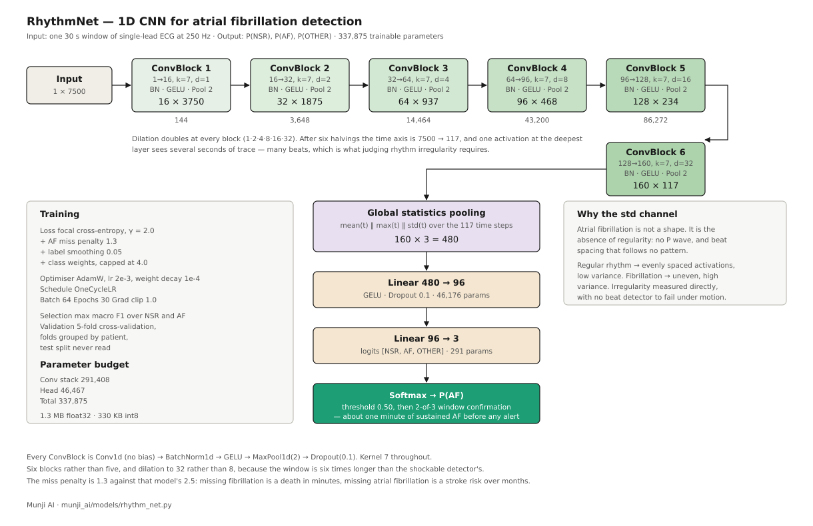

# RhythmNet — Model Card

| | |
|---|---|
| **Model** | `munji_ai/models/rhythm_net.py` |
| **Task** | Classify 30-second windows of single-lead ambulatory ECG as normal sinus rhythm, atrial fibrillation, or other rhythm |
| **Version** | 1.0 · October 2026 |
| **Repository** | `github.com/furatsafa2001/munji_ai` |
| **Author** | Safa Khan, AI team |
| **Organisation** | مؤسسة عبدالرحمن المعشي لهندسة البرمجيات (Abdulrahman Al-Maashi Software Engineering Est.) |

---

## 0. Where this sits in the client specification

The specification lists twenty conditions across five stages. This model is
one stage of five, and covers one of the twenty by name.

| Stage | Conditions | Status |
|---|---|---|
| 1. Signal quality gate | noise, lead-off | written, not trained |
| 2. Rate engine | bradycardia, tachycardia, extreme brady/tachy, pause, asystole, SVT, wide-complex tachycardia | **written and tested** |
| 3a. **Rhythm classifier — this model** | **atrial fibrillation** (atrial flutter folded in) | **trained and evaluated** |
| 3b. Beat classifier | PVC, PAC, couplets, bigeminy, trigeminy | written, not trained |
| 3c. Shockable detector | VF, rapid VT | trained and evaluated |
| 4. ST/T trend | ST elevation, ST depression, T-wave inversion | not built |
| 5. Decision layer | combine, grade, route the alert | not built |

### What this model is asked for, and what it delivers

The specification names three conditions that a rhythm classifier might carry:
atrial fibrillation, atrial flutter, and SVT. It delivers one of them cleanly,
and the reasons for the other two are measured rather than assumed.

**Atrial fibrillation — delivered.** Sensitivity 0.920, specificity 0.973.

**Atrial flutter — folded into the AF label, not separate.** `windows.py` maps
the AFL annotation onto AF rather than OTHER, which is a decision taken before
this work and one the literature supports: the 2025 ConvNeXt detector merges
fibrillation and flutter into a single class. It is also the only option the
data allows — counting rhythm markers across every registered source gives 59
AFL markers in total. **When this model reports AF, flutter is included in
that report.** That must be stated wherever the output is shown.

**SVT — not this model's job, by design.** It was tried as a fourth class and
produced 5 training windows. The reason is arithmetic: a 30-second window
needs 21 continuous seconds of one rhythm to carry its label at
`RHYTHM_PURITY = 0.7`, and SVT runs are far shorter — a dedicated PSVT study
excluded 51 of its own patients for episodes under 10 seconds. SVT is instead
handled by the rate engine, where `FAST_NARROW_BPM = 150` and
`NARROW_QRS_MS = 120` define it as a rule: fast rate with a narrow complex.
Those constants were already in `config.py` before this attempt, which is the
clearest statement that the architecture never intended SVT to be a learned
class.

**The OTHER class carries everything else.** It is not a diagnosis. It means
"a rhythm that is neither sinus nor fibrillation", and the app must present it
that way — as a flag for review, not as a named condition.

---

## 1. Purpose and scope

Atrial fibrillation is the largest modifiable risk factor for stroke, it is
often paroxysmal, and a clinic ECG therefore misses it. Continuous monitoring
is the only way to catch it, which is what this model is for.

It does **not** detect ischaemia, infarction, valve disease, heart failure, or
conduction block. It does not replace clinical judgement. Its output is a flag
for a caregiver, confirmed over about a minute of signal before anyone is
contacted.

---

## 2. Data

### 2.1 Sources

| Database | Version | Records | Native rate | Contribution |
|---|---|---|---|---|
| CinC Challenge 2017 | 1.0.0 | 8,528 | 300 Hz | the OTHER class, and most of the patients |
| Icentia11k | 1.0 | 235 patients | 250 Hz | ambulatory patch recordings, NSR and AF |
| LTAFDB | 1.0.0 | 84 | 128 Hz | long-term AF with episode boundaries |
| NSRDB | 1.0.0 | 18 | 128 Hz | screened healthy sinus rhythm |
| MITDB | 1.0.0 | 48 | 360 Hz | benchmark, test split only |
| AFDB | 1.0.0 | 23 usable | 250 Hz | benchmark, test split only |

**Why CinC 2017 was added.** Before it, OTHER had 34 training windows against
190 in test — a class the model could not learn but was scored on. Raising
Icentia from 145 patients to 235 moved it from 26 to 34, which showed the
shortage was in what the sources contain, not how much of them was read:
LTAFDB, Icentia and NSRDB are all effectively binary.

CinC 2017 was built for this exact problem. Its task is to sort single-lead
recordings into normal, AF, other, or too noisy, and its class counts are
N 5,076 / A 758 / **O 2,415** / noisy 279. It also matches this stage
precisely: single lead, and every recording is 9,000 samples at 300 Hz —
30.0 seconds, which is the window length. One recording becomes one window.

After adding it, OTHER went from 34 training windows to 2,141.

### 2.2 Annotation handling

**Per-record labels.** CinC 2017 holds its labels in a CSV beside the data,
one per recording, not in `.atr` files. `baseline_rhythm` could not express
that — it is a single rhythm for an entire dataset — so `label_file` and
`label_map` were added to the registry and a six-line branch to the loader.
The branch fires only for datasets that declare a label file, which is this one
and no other.

| CSV label | Rhythm token | Class |
|---|---|---|
| `N` | `(N` | NSR |
| `A` | `(AFIB` | AF |
| `O` | `(OTHER` | OTHER |
| `~` | `(NOISE` | dropped |

Noisy recordings map onto the ambiguous token and are discarded rather than
assigned to a class.

**Atrial flutter** is mapped onto AF upstream, as described in §0.

**Validation folder removed before use.** CinC 2017 ships a `validation/`
directory holding 300 recordings that also appear in `training/` under the same
names. Loading both would have fed each of them twice.

### 2.3 Windows and splits

| Parameter | Value |
|---|---|
| Window | 30.0 s (7,500 samples at 250 Hz) |
| Stride | 15.0 s (50% overlap) |
| Rhythm purity | one rhythm must cover ≥ 70% of the window |
| Per-patient cap | 80 windows |
| Split | 70 / 15 / 15 **by patient**, seed 20260817 |

Thirty seconds is not arbitrary. Atrial fibrillation is not a shape in one
beat; it is an absence — no P wave — and an irregularity with no pattern.
Judging that no pattern exists needs enough beats to establish it. At a resting
rate a five-second window holds five or six beats, which cannot separate
irregular from merely variable. Thirty seconds holds about thirty.

| Split | Windows | Patients | NSR | AF | OTHER |
|---|---|---|---|---|---|
| train | 14,340 | 5,454 | 7,656 | 4,543 | 2,141 |
| val | 3,081 | 1,163 | 1,724 | 871 | 486 |
| test | 6,059 | 1,206 | 3,140 | 2,308 | 611 |

Splitting is at patient level, with a leak check at build time.

**One caveat on patient identity.** CinC 2017 provides no subject identifiers,
so each recording is treated as its own patient. If one person contributed two
recordings, they could land in different folds. The challenge itself scored
recordings independently and nothing in the release allows grouping them, so
this is a property of the source rather than a choice.

---

## 3. Preprocessing

1. **Resample to 250 Hz.** Native rates span 128 to 360 Hz.
2. **Band-pass 0.5 – 40 Hz**, 4th-order Butterworth, zero-phase, so R-peak
   timing is preserved.
3. **Robust normalisation** per window: subtract the median, divide by the
   interquartile range. Scale-free, and a single motion spike barely moves it.
4. **Window extraction** as in §2.3.

The signal quality gate runs upstream in deployment at `GATE_MIN_P["rhythm"]
= 0.60`, which is deliberately more permissive than the 0.90 the beat
classifier demands: rhythm needs R-peak timing, not clean morphology.

---

## 4. Architecture



### 4.1 Layer by layer

| Stage | Layer | Output | Parameters |
|---|---|---|---|
| Input | — | 1 × 7500 | — |
| ConvBlock 1 | Conv1d 1→16, k=7, d=1 · BN · GELU · Pool 2 · Drop 0.1 | 16 × 3750 | 144 |
| ConvBlock 2 | Conv1d 16→32, k=7, d=2 · BN · GELU · Pool 2 · Drop 0.1 | 32 × 1875 | 3,648 |
| ConvBlock 3 | Conv1d 32→64, k=7, d=4 · BN · GELU · Pool 2 · Drop 0.1 | 64 × 937 | 14,464 |
| ConvBlock 4 | Conv1d 64→96, k=7, d=8 · BN · GELU · Pool 2 · Drop 0.1 | 96 × 468 | 43,200 |
| ConvBlock 5 | Conv1d 96→128, k=7, d=16 · BN · GELU · Pool 2 · Drop 0.1 | 128 × 234 | 86,272 |
| ConvBlock 6 | Conv1d 128→160, k=7, d=32 · BN · GELU · Pool 2 · Drop 0.1 | 160 × 117 | 143,680 |
| Global pooling | concat[ mean(t), max(t), std(t) ] | 480 | — |
| Head | Linear 480→96 · GELU · Dropout 0.1 | 96 | 46,176 |
| Output | Linear 96→3 | 3 | 291 |
| **Total** | | | **337,875** |

**Footprint.** 1.32 MB in float32, roughly 330 KB in int8. Six times the input
length of the shockable detector, at roughly double the parameters.

### 4.2 Design rationale

**Six blocks, dilation to 32.** The input is six times longer than the
shockable detector's, so the receptive field has to span many beats rather than
one complex. Dilation widens it without adding parameters.

**Standard deviation in the pooling.** Mean and max are the usual two. The
third channel is there because it encodes the distinction this task turns on:
regular rhythm produces evenly spaced activations and low variance,
fibrillation produces uneven ones and high variance. It measures irregularity
without detecting a single beat, which is why it survives motion artifact where
an R-peak detector does not.

**Raw signal rather than RR-interval statistics.** Classical AF detectors
measure beat spacing first, then judge its irregularity. This model gets the
trace and must find the beats itself. The cost is interpretability; the benefit
is that there is no R-peak detector to fail under motion artifact, which is the
most common way an ambulatory pipeline breaks. Guided Grad-CAM on a comparable
architecture confirmed such networks attend to P-wave absence and R-R
irregularity on their own.

**A local copy of `ConvBlock`.** Each of the four models keeps its own rather
than importing a shared one. They are tuned against different failure modes,
and a change made for one must not silently alter another.

---

## 5. Training

### 5.1 Loss

```python
RhythmLoss(
    class_weights   = inverse frequency, capped at 4.0,
    af_miss_penalty = 1.3,
    label_smoothing = 0.05,
    gamma           = 2.0,
)
```

**Focal modulation (γ = 2.0)** down-weights windows already classified
correctly, so the gradient reaches the boundary cases instead of the thousands
of obvious sinus windows. It also regularises confidence.

**AF miss penalty of 1.3**, against 2.5 in the shockable detector. The
asymmetry is real but not comparable: a missed fibrillation is a death in
minutes; a missed atrial fibrillation is a stroke risk left unflagged over
months, with thousands more windows coming from the same patient. Weighting it
harder would buy a small gain in recall with a flood of false alarms.

**Class weights capped at 4.0.** Uncapped inverse frequency gave OTHER a weight
near 92 when it held 34 windows. The model would have spent its capacity
chasing a class it could not learn. The cap makes a class's weight reflect its
importance rather than the scarcity of its examples.

### 5.2 Optimisation

| | |
|---|---|
| Optimiser | AdamW, lr 2 × 10⁻³, weight decay 10⁻⁴ |
| Schedule | OneCycleLR |
| Batch | 64 |
| Epochs | 30 |
| Gradient clipping | L2 norm 1.0 |
| Device | Apple MPS |

### 5.3 Model selection

Validation macro F1 over **NSR and AF only**. OTHER is scored, printed and
counted in the confusion matrix, but does not choose the checkpoint.

That rule was set when OTHER had 34 windows and its F1 swung on a handful of
predictions. With 2,141 windows the case for excluding it is weaker, and it
should be revisited at the next training run. It is recorded here because it
affects which epoch was kept.

### 5.4 Validation protocol

Five-fold cross-validation, folds grouped by patient, over the pooled train and
validation splits: **17,421 windows from 6,617 patients**. Each patient is
predicted exactly once by a model that never saw them. The test split has not
been read.

Two seeds were run. Macro F1 came out identical to three decimal places
(0.925 and 0.925), and no metric moved by more than 0.005. With 6,617 patients
the seed-to-seed variation is negligible, unlike the shockable detector at 199
patients where it reached ±0.012.

### 5.5 Confirmation rule

`CONFIRMATION["af"] = (2, 3)`: two positive windows among any three
consecutive before an alert. At a 15-second stride that is about a minute of
sustained AF — deliberate, since paroxysmal AF matters over months and a single
noisy window must never raise an alarm.

---

## 6. Results

Out-of-fold: every window scored by a model that did not train on its patient.

### 6.1 Headline

| Metric | 5-fold mean ± sd | Pooled OOF |
|---|---|---|
| AF sensitivity | 0.926 ± 0.033 | 0.920 |
| AF specificity | 0.970 ± 0.009 | 0.973 |
| Macro F1 (NSR, AF) | 0.923 ± 0.007 | 0.925 |
| Macro F1 (all three) | — | **0.859** |
| ROC AUC (AF) | 0.982 ± 0.007 | 0.979 |
| Average precision | — | 0.968 |

Two macro F1 figures appear because they measure different things. The
selection metric covers NSR and AF, which is what chose the epoch. The
three-class figure includes OTHER and is the one to quote as overall
performance.

### 6.2 Per class

| Class | Sensitivity | Specificity | Precision | F1 | Support |
|---|---|---|---|---|---|
| NSR | 0.934 | 0.901 | 0.921 | 0.928 | 1,702 |
| AF | 0.956 | 0.979 | 0.949 | 0.952 | 899 |
| OTHER | 0.710 | 0.958 | 0.758 | 0.733 | 480 |

*(single-split validation figures; the cross-validated confusion matrix is in §6.3)*

### 6.3 Pooled confusion matrix, 6,617 patients

| true ↓ / predicted → | NSR | AF | OTHER |
|---|---|---|---|
| **NSR** | 8,793 | 220 | 367 |
| **AF** | 234 | 5,038 | 142 |
| **OTHER** | 740 | 134 | 1,753 |

The OTHER row is where the weakness sits: 740 windows of abnormal rhythm were
called normal, against 134 called AF. That ratio — confusion with normal far
more than with AF — is exactly what the CinC 2017 entries reported. One wrote
that the class "is mistaken for AF and even more for Normal", and that the
network "struggles to generalise the Other class, maybe the intra-class
variability is too impacting". OTHER is not one rhythm; it is every rhythm that
is neither of the other two.

### 6.4 Episode level, after confirmation

| | |
|---|---|
| Episodes caught | 285 |
| Episodes missed | 39 |
| Episode sensitivity | 0.880 |
| False alarms | 25 |

**This metric needed fixing before it meant anything.** It first read 0.417
while window-level AF sensitivity was 0.956. The cause was the data, not the
model: the rule needs three consecutive windows, and most records here are
shorter than that — CinC 2017 gives one 30-second recording per subject, which
is one window, and Icentia segments give about two. Every episode in a record
too short to confirm counted as missed no matter how well it was classified.

Records that cannot support the rule are now excluded and the exclusion is
reported, which is the published convention: short single-recording sets are
scored per recording, long-term sets with marked episode boundaries are scored
per episode, and clinical studies that do both report them separately. A
deployed patch records continuously, so every real episode spans many windows;
the exclusion is an artefact of evaluating on archives.

### 6.5 Per patient

Of 6,617 patients, 6,333 contributed fewer than five windows and are excluded
from the per-patient view — a one-window record scores 0.0 or 1.0 and ranks as
noise. They are covered by the window-level figures.

Of the 284 patients with five or more windows, 18 have an error rate above
0.20. All are from Icentia11k and LTAFDB: long recordings from real patients,
where a single difficult stretch can dominate.

### 6.6 Comparison with published work

The CinC 2017 task is the closest published benchmark: same four-way framing,
same class definitions.

| Study | NSR F1 | AF F1 | OTHER F1 | Mean |
|---|---|---|---|---|
| Challenge winner (2017) | — | — | — | 0.826 |
| Philips (Rubin et al.) | 0.90 | 0.80 | 0.70 | 0.800 |
| MCNN-BLSTM (2022) | — | — | — | 0.846 |
| **RhythmNet** | **0.928** | **0.952** | **0.733** | **0.859** |

The comparison is indicative, not exact: our validation pool mixes CinC 2017
with Icentia, LTAFDB and NSRDB rather than being CinC alone, and the class
balance differs. The pattern holds regardless — strong on the two named
classes, and OTHER in line with Philips at 0.70.

---

## 7. Known limitations

**OTHER is a bucket, not a diagnosis.** It holds atrial flutter, SVT,
bradycardia, block and ectopy together. At 0.710 sensitivity it is the weakest
output and must be presented as "a rhythm to review", never as a named
condition.

**Atrial flutter is reported as AF.** Fifty-nine markers across every open
source is not enough to separate it. Wherever the AF output is shown, this has
to be said.

**SVT is not here.** It is the rate engine's, by design and by measurement
(§0).

**Training AF prevalence is unrealistic.** AF is 32% of training windows and
near zero in a home monitor. At field prevalence the same specificity produces
proportionally more false alarms; the confirmation rule and the quality gate
are the mitigations.

**CinC 2017 was recorded on a handheld AliveCor device**, not a chest patch.
Electrode placement and contact differ from the deployment hardware.

**No subject grouping in CinC 2017.** See §2.3.

**Single lead.** One projection of the cardiac vector, and not designed for
ischaemia.

**Not clinical judgement.** The output is an alert to a caregiver. Every alert
should be acted on by a person.

---

## 8. Files

| Path | Role |
|---|---|
| `munji_ai/models/rhythm_net.py` | Model, loss, class weights |
| `munji_ai/train/train_rhythm.py` | Training, episode-level reporting |
| `munji_ai/train/cross_validate.py` | Patient-grouped k-fold |
| `munji_ai/eval/plot_eval.py` | Confusion, ROC/PR, score distribution, per patient |
| `munji_ai/rules/rate_engine.py` | Rate conditions including SVT |
| `munji_ai/data/registry.py` | Dataset definitions, `label_file` mechanism |
| `munji_ai/data/loader.py` | Annotation parsing, per-record labels |
| `munji_ai/config.py` | All thresholds |

---

## 9. References

1. Clifford GD, Liu C, Moody B, et al. AF Classification from a Short Single Lead ECG Recording: the PhysioNet/Computing in Cardiology Challenge 2017. *Comput Cardiol.* 2017. https://physionet.org/content/challenge-2017/1.0.0/
2. Rubin J, Parvaneh S, Rahman A, et al. Densely Connected Convolutional Networks and Signal Quality Analysis to Detect Atrial Fibrillation Using Short Single-Lead ECG Recordings. *Comput Cardiol.* 2017. https://arxiv.org/abs/1710.05817
3. Atrial Fibrillation and Atrial Flutter Detection Using Deep Learning. 2025. https://www.ncbi.nlm.nih.gov/pmc/articles/PMC12251829/ — ConvNeXt on Icentia11k and LTAF; Grad-CAM on P-wave absence and RR irregularity; AF and AFL merged.
4. An Effective Atrial Fibrillation Detection from Short Single-Lead ECG Recordings Using MCNN-BLSTM Network. *Algorithms.* 2022. https://doi.org/10.3390/a15120454
5. Mukhoti J, Kulharia V, Sanyal A, et al. Calibrating Deep Neural Networks using Focal Loss. *NeurIPS.* 2020. https://arxiv.org/abs/2002.09437
6. Mousavi S, Afghah F, Razi A, Acharya UR. ECGNET: Learning where to attend for detection of atrial fibrillation with deep visual attention. *arXiv:1812.07422.* https://arxiv.org/pdf/1812.07422
7. A deep learning model based on combining surface and esophageal ECG data for diagnosis of paroxysmal supraventricular tachycardia. 2026. https://pmc.ncbi.nlm.nih.gov/articles/PMC13250415/ — PSVT episode durations.
8. Goldberger AL, Amaral LAN, Glass L, et al. PhysioBank, PhysioToolkit, and PhysioNet. *Circulation.* 2000;101(23):e215–e220.
9. Icentia11k — https://physionet.org/content/icentia11k-continuous-ecg/1.0/
10. LTAFDB — https://physionet.org/content/ltafdb/1.0.0/
11. NSRDB — https://physionet.org/content/nsrdb/1.0.0/
12. MITDB — https://physionet.org/content/mitdb/1.0.0/
13. AFDB — https://physionet.org/content/afdb/1.0.0/
