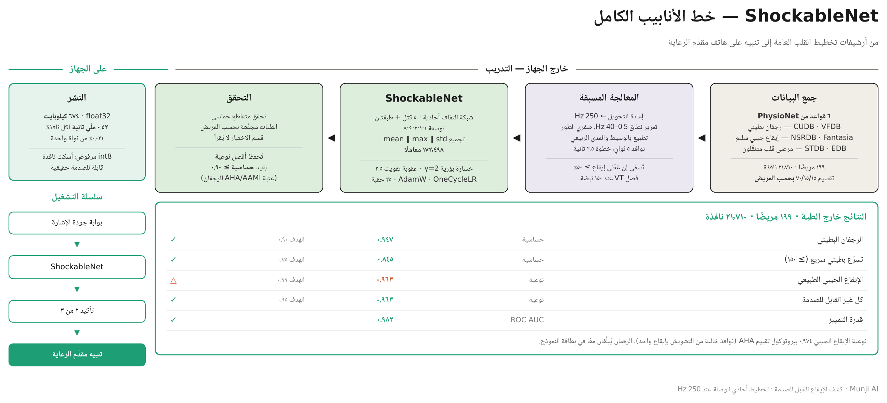

# بطاقة النموذج — ShockableNet

| | |
|---|---|
| **النموذج** | `munji_ai/models/shockable_net.py` |
| **المهمة** | كشف الإيقاع البطيني القابل للصدمة (الرجفان البطيني والتسرّع البطيني السريع) في نوافذ ٥ ثوانٍ من تخطيط قلب متنقّل أحادي الوصلة |
| **الإصدار** | ١.٠ · أكتوبر ٢٠٢٦ |
| **المستودع** | `github.com/furatsafa2001/munji_ai` |
| **الكاتبة** | صفاء خان، فريق الذكاء الاصطناعي |
| **الجهة** | مؤسسة عبدالرحمن المعشي لهندسة البرمجيات |

---

## ٠ · خط الأنابيب في لمحة



---

## ١ · الغرض والنطاق

Munji لاصقة تخطيط قلب أحادية الوصلة للمراقبة المنزلية المستمرة لمرضى القلب، مع تنبيه مقدّم الرعاية. ShockableNet هو المكوّن المسؤول عن الحدث الوحيد الذي يقتل خلال دقائق: إيقاع بطيني لم يعد يضخّ الدم. يصنّف كل نافذة مدتها ٥ ثوانٍ إلى `shockable` أو `not_shockable`، ويغذّي مخرجه قاعدة تأكيد قبل أي إنذار.

النموذج **لا** يكشف نقص التروية ولا الاحتشاء ولا أمراض الصمامات ولا قصور القلب. نطاقه الفئتان المذكورتان أعلاه فقط، ولا يُقرأ مخرجه على أنه غياب لأي مرض آخر.

---

## ٢ · البيانات

### ٢.١ المصادر

كل البيانات عامة من PhysioNet. ست قواعد تغذّي هذه المرحلة.

| القاعدة | الإصدار | التسجيلات | المعدل الأصلي | دورها هنا | نوع التوسيم |
|---|---|---|---|---|---|
| CUDB — Creighton University Ventricular Tachyarrhythmia | 1.0.0 | ٣٥ | 250 Hz | إيجابيات وسلبيات | توسيم نبضات + رموز أحداث `[` `]` لنوبات الرجفان |
| VFDB — MIT-BIH Malignant Ventricular Arrhythmia | 1.0.0 | ٢٢ | 250 Hz | إيجابيات وسلبيات | تسميات إيقاع في `aux_note` |
| NSRDB — MIT-BIH Normal Sinus Rhythm | 1.0.0 | ١٨ | 128 Hz | سلبيات | توسيم نبضات فقط |
| Fantasia | 1.0.0 | ٤٠ | 250 Hz | سلبيات | توسيم نبضات فقط (`.ecg`) |
| STDB — MIT-BIH ST Change | 1.0.0 | ٢٨ | 360 Hz | سلبيات | توسيم نبضات فقط |
| EDB — European ST-T | 1.0.0 | ٩٠ | 250 Hz | سلبيات | تسميات إيقاع + علامات نوبات ST/T |

**لماذا هذه الست.** CUDB و VFDB هما القاعدتان المعياريتان للإيقاع القابل للصدمة في أدبيات أجهزة AED، والمصدران المفتوحان الوحيدان للرجفان البطيني بتوسيم على مستوى الإيقاع. الأربع الأخرى أُضيفت لتوفير إيقاع عادي من الفئة التي صُمّم لها الجهاز. NSRDB تضيف إيقاعًا جيبيًا سليمًا مُغربَلًا؛ Fantasia تضيف ٢٠ مسنًّا سليمًا؛ STDB تضيف مرضى قلب في إيقاع جيبي أثناء الجهد؛ EDB تضيف ٧٩ مريض قلب متنقّلًا بأعمار ٣٠ إلى ٨٤. معًا تغطّي الشباب والمسنّين، الأصحاء والمرضى، في الراحة والحركة.

### ٢.٢ معالجة التوسيم

كل قاعدة تشفّر الإيقاع بطريقة مختلفة، وتطلّب الأمر حلّ عدة اصطلاحات قبل أن تصبح التسميات صالحة.

**CUDB.** نوبات الرجفان معلَّمة برمزَي أحداث WFDB هما `[` (البداية) و `]` (النهاية)، لا بسلاسل إيقاع. ما قبل أول `[` يُسمّى `(N` لأنه بالتعريف ما قبل التوقف. وما بعد `]` يُسمّى `UNKNOWN` ويُرمى: حالة ما بعد الرجفان غير معلومة الأمان.

**VFDB.** تسميات الإيقاع في `aux_note`. علامة `(NOISE` تُبقى كعلامة فترة لا تُحذف، لأن مفتاح توسيم PhysioNet ينصّ على أن الإيقاع السابق يستمر خلال نوبة الضوضاء؛ والنوافذ التي تغلب عليها تُرمى.

**التسرّع البطيني.** تسمّيه القواعد `VT` بلا معدل. وفق مخطط تصنيف الإيقاعات المعتمد من AHA، التسرّع البطيني عند ≥ ١٥٠ نبضة قابل للصدمة والأبطأ وسيط. يُقاس المعدل من الإشارة (VFDB بلا توسيم نبضات) بكشف القمم على الإشارة المقوَّمة؛ النوبات عند ≥ ١٥٠ تصبح `VT_FAST` وتدخل الفئة الإيجابية، والأبطأ تُستبعد من هذه المرحلة.

**القواعد ذات توسيم النبضات فقط (NSRDB و Fantasia و STDB).** لا تحمل علامات تغيّر إيقاع. حقل `baseline_rhythm` في الريجستري يعلن التسجيل كله جيبيًا — آمن بالبناء لـ NSRDB و Fantasia اللتين غُربل مرضاهما، وافتراض لاختبارات الجهد المُشرَف عليها في STDB أيّده القياس (حساسية VF لم تتغير بعد إضافتها).

**EDB.** علامات نوبات ST و T تُترك خارج خريطة الإيقاع، فيعاملها المحمّل كإيقاع غير معروف ويرمي النوافذ التي تغلب عليها. يخسر هذا تغطية لكنه لا يخطئ في تسمية.

### ٢.٣ تعريف الفئة

```
SHOCKABLE_RHYTHMS   = ("VF", "VT_FAST")      # VFL تُعيَّن إلى VF قبل هذه المرحلة
VT_FAST_BPM         = 150.0
SHOCKABLE_EXCLUDED  = ("NOISE", "UNKNOWN", "VT")   # VT غير مقيس أو بطيء
```

### ٢.٤ النوافذ والتقسيم

| المعامل | القيمة |
|---|---|
| النافذة | ٥.٠ ثانية (١٢٥٠ عيّنة عند 250 Hz) |
| الخطوة | ٢.٥ ثانية (تداخل ٥٠٪) |
| نقاء الإيقاع | تُسمّى النافذة فقط إن غطّى إيقاع واحد ≥ ٥٠٪ منها |
| السقف لكل مريض | ٤٠٠ نافذة، مع أولوية للنوافذ الحاملة لنوبات |
| التقسيم | ٧٠ / ١٥ / ١٥ **بحسب المريض**، بذرة 20260817 |

التقسيم على مستوى المريض: لا يظهر شخص في أكثر من قسم. فحص تسريب يعمل عند البناء ويُوقفه عند أي تداخل.

| القسم | النوافذ | المرضى | shockable | not_shockable |
|---|---|---|---|---|
| train | ١٨,٢٢٨ | ١٦٧ | ١,٦٢٧ | ١٦,٦٠١ |
| val | ٣,٤٨٢ | ٣٢ | ٤٤٦ | ٣,٠٣٦ |
| test | ٣,٦٣٨ | ٣٣ | ٣٤٠ | ٣,٢٩٨ |

قسم الاختبار لم يُقرأ في أي مرحلة من التطوير، ومحجوز لقياس نهائي واحد.

---

## ٣ · المعالجة المسبقة

كل المدخلات تمرّ عبر `munji_ai/data/preprocess.py`.

١. **إعادة التحويل إلى 250 Hz** — إعادة عيّنة متعددة الأطوار من scipy. المعدلات الأصلية بين ١٢٨ و٣٦٠ هرتز. CUDB و VFDB و Fantasia و EDB أصلًا 250 Hz وتمرّ بلا تغيير.
٢. **مرشّح تمرير نطاق 0.5 – 40 Hz** — Butterworth من الرتبة الرابعة، صفري الطور (`sosfiltfilt`)، فيُحفظ توقيت قمم R (انحراف مقيس: صفر عيّنة). يُحفظ مسار تشخيصي منفصل عند 0.05 – 40 Hz مع مرشّح حزّ 50 Hz للتخزين؛ هذا النموذج لا يستخدمه.
٣. **التطبيع المتين** — لكل نافذة، يُطرح الوسيط ويُقسَم على المدى الربيعي. مستقل عن المقياس، فقاعدة بمعامل تحويل خاطئ تُطبَّع إلى نفس نتيجة قاعدة بوحدات صحيحة؛ وقفزة حركة واحدة بالكاد تحرّك المقياس.
٤. **استخراج النوافذ** كما في §٢.٤.

لا يُطبَّق تضخيم في هذه المرحلة. بوابة جودة الإشارة (نموذج منفصل) تعمل قبل هذا النموذج عند التشغيل وليست جزءًا من مدخله.

---

## ٤ · المعمارية


### ٤.١ طبقة بطبقة

| المرحلة | الطبقة | شكل المخرج | المعاملات |
|---|---|---|---|
| المدخل | — | 1 × 1250 | — |
| ConvBlock 1 | Conv1d 1→16, k=7, d=1 · BN · GELU · MaxPool 2 · Dropout 0.1 | 16 × 625 | ١٤٤ |
| ConvBlock 2 | Conv1d 16→32, k=7, d=1 · BN · GELU · MaxPool 2 · Dropout 0.1 | 32 × 312 | ٣,٦٤٨ |
| ConvBlock 3 | Conv1d 32→64, k=7, d=2 · BN · GELU · MaxPool 2 · Dropout 0.1 | 64 × 156 | ١٤,٤٦٤ |
| ConvBlock 4 | Conv1d 64→96, k=7, d=4 · BN · GELU · MaxPool 2 · Dropout 0.1 | 96 × 78 | ٤٣,٢٠٠ |
| ConvBlock 5 | Conv1d 96→128, k=7, d=8 · BN · GELU · MaxPool 2 · Dropout 0.1 | 128 × 39 | ٨٦,٢٧٢ |
| التجميع العام | concat[ mean(t), max(t), std(t) ] | 384 | — |
| الرأس | Linear 384→64 · GELU · Dropout 0.1 | 64 | ٢٤,٦٤٠ |
| المخرج | Linear 64→2 | 2 | ١٣٠ |
| **المجموع** | | | **١٧٢,٤٩٨** |

**البصمة على الجهاز.** ٦٧٤ كيلوبايت بدقة float32، و٢٠.٣ مليون عملية ضرب وجمع لكل نافذة
٥ ثوانٍ. على خيط واحد من معالج Apple M-series، ٠.٥٢ ملّي ثانية لكل نافذة مقابل خطوة ٢.٥ ثانية،
أي دورة عمل ٠.٠٢١٪ من نواة واحدة، أو نحو ٠.١٠٪ على معالج هاتف أبطأ خمس مرات.

**يُشحن بدقة float32 عن قصد.** التكميم الديناميكي إلى int8 يصغّر الأوزان إلى ١٦٨ كيلوبايت،
لكنه لا يوفّر زمنًا إطلاقًا (٠.٥٤ مقابل ٠.٥٢ ملّي ثانية)، ويغيّر ثلاثة قرارات على ٢,٠٠٠ نافذة
تحقق، أحدها يحوّل نافذة قابلة للصدمة فعلًا إلى "آمنة". عدّ القرارات المتغيّرة كان سيصفها بأنها
مهملة عند ٠.١٥٪؛ قراءة اتجاهها تقول غير ذلك. نصف ميغابايت لا يساوي تفويتًا جديدًا في الفئة
الوحيدة التي وُجد هذا النموذج لالتقاطها.

### ٤.٢ مبررات التصميم

**صغير عمدًا.** النموذج يعمل على هاتف بجانب ثلاث شبكات أخرى (جودة الإشارة، تجزئة النبضات، تصنيف الإيقاع). عند ١٧٢ ألف معامل هو أقل بمرتبة كاملة من كاشفات ConvNeXt الحديثة ذات ٧٧٠ ألفًا، وضمن ميزانية الخوارزميات التجارية المزروعة بكثير. مكدّس التفافي من خمس كتل ورأس بطبقتين يتبع النمط المنشور لكشف اضطرابات النظم البطينية على المنصات محدودة الموارد.

**التوسعة بدل العمق.** التوسعة تتضاعف من الكتلة الثالثة (١، ١، ٢، ٤، ٨)، فيمتدّ المجال الاستقبالي عند الكتلة الأخيرة عبر نحو ١.٦ ثانية من الإشارة — عدة نبضات — دون معاملات إضافية. الرجفان خاصية للأثر كله لا لمركّب واحد، والشبكة تحتاج رؤية ما يكفي منه للحكم.

**تجميع بثلاث إحصاءات.** المتوسط والأقصى هما الخياران المعتادان. أُضيف الانحراف المعياري عبر الزمن لأنه يشفّر مباشرة الفرق الذي تدور عليه المهمة: الإيقاع المنتظم ينتج تفعيلات مسنّنة عالية التباين (مركّب QRS ثم سكون)، بينما الرجفان ينتج نشاطًا متواصلًا وتباينًا منخفضًا. هو قياس لعدم الانتظام دون كشف نبضة واحدة، ولذلك يبقى متينًا تحت ضوضاء الحركة حيث تفشل كواشف قمم R.

**نسخة محلية من ConvBlock.** كل نموذج من الأربعة يحتفظ بـ `ConvBlock` خاصّته بدل استيراد نسخة مشتركة. النماذج مضبوطة ضد أنماط فشل مختلفة، وتعديل يُجرى لبوابة الجودة يجب ألّا يغيّر بصمت كاشفًا تُعدّ حساسيته ادّعاء سلامة.

**التوافق مع الأدبيات.** المعمارية تصميم داخلي للمشروع لا إعادة إنتاج لورقة. خياراتها تقع ضمن الممارسة المنشورة: خمس كتل التفافية ورأس بطبقتين يطابقان الكاشف محدود الموارد في Zhao et al. (arXiv 2008.08060)؛ نافذة ٥ ثوانٍ تطابق طول المقطع المستخدم على نفس القواعد في أعمال Hybrid 1D-CNN/Bi-LSTM؛ وعدد المعاملات يقع بين خط الأساس ٧٠ ألفًا والنموذج الرئيسي ٧٧٠ ألفًا في كاشف AF المبني على ConvNeXt سنة ٢٠٢٥.

---

## ٥ · التدريب

### ٥.١ دالة الخسارة

```python
MissPenaltyLoss(
    class_weights   = أوزان عكسية التردد على {shockable, not_shockable},
    miss_penalty    = 2.5,     # مضاعِف على السلبيات الكاذبة
    label_smoothing = 0.05,
    gamma           = 2.0,     # التعديل البؤري (1 - p)^gamma
)
```

ثلاثة مكوّنات، كل واحد يعالج مشكلة مختلفة.

**التعديل البؤري (γ = 2.0)** يقلّل وزن النوافذ التي يصنّفها النموذج صحيحًا أصلًا، فلا يسيطر على التدرّج آلاف نوافذ الإيقاع الجيبي الواضحة، ويذهب بدلًا من ذلك للحالات الحدّية. ويضبط الثقة أيضًا: الإنتروبيا المتقاطعة معروفة بإنتاج تنبؤات مفرطة الثقة في الشبكات عالية السعة، وتعمل الخسارة البؤرية كمنظّم ضمني للإنتروبيا. القيمة γ = 2 هي الافتراضية المنشورة والمستخدمة في التقييم المقارن لمعماريات ECG سنة ٢٠٢٦. وضبط γ = 0 يعيد الإنتروبيا المتقاطعة الموزونة بالضبط، ما جعل المقارنة محكومة.

**عقوبة التفويت (٢.٥)** تضاعف الخسارة على السلبيات الكاذبة. تفويت الرجفان وإطلاق إنذار كاذب ليسا متساويي الكلفة — الأول وفاة خلال دقائق، والثاني مكالمة هاتفية. والعقوبة محدودة: لو دُفعت أبعد، يسمّي النموذج كل شيء قابلًا للصدمة، فتبلغ الحساسية ١.٠ وتنهار النوعية، وهذا فشل لا يظهر في عمود الحساسية.

**تنعيم التسميات (٠.٠٥)** يليّن الأهداف قليلًا. وثائق CUDB نفسها تصف حدود نوباتها بأنها تقريبية، فالتسميات الحادة عند الحواف دقة زائفة.

### ٥.٢ التحسين

| | |
|---|---|
| المحسّن | AdamW، معدل تعلم 3 × 10⁻³، اضمحلال وزن 10⁻⁴ |
| الجدولة | OneCycleLR على كامل التشغيل |
| الدفعة | ١٢٨ |
| الحقب | ٢٥ (إيقاف مبكر بصبر ٨ في سكربت التقسيم الواحد) |
| قصّ التدرّج | معيار L2 عند ١.٠ |
| الجهاز | Apple MPS |

### ٥.٣ اختيار النموذج

مقياس التحقق هو **النوعية بقيد حساسية ≥ ٠.٩٠**. الحساسية قيد لا هدف: من بين الحقب التي تتجاوز عتبة AHA/AAMI للرجفان البطيني، تُحفظ ذات النوعية الأعلى. وإن لم تتجاوز أي حقبة العتبة، لا يُحفظ شيء ويقول السكربت ذلك. العتبة غير قابلة للتفاوض ولا تُخفَّض أبدًا لتمرير تشغيل.

### ٥.٤ بروتوكول التحقق

تحقق متقاطع خماسي، الطيات مجمَّعة بحسب المريض، على مجموع قسمَي التدريب والتحقق (٢١,٧١٠ نافذة، ١٩٩ مريضًا). كل مريض يُتنبَّأ به مرة واحدة بالضبط بنموذج لم يره قط. قسم الاختبار لا يُقرأ.

الأرقام المُبلَّغة هي المتوسط والانحراف المعياري عبر الطيات، والمقاييس المجمَّعة خارج الطية على كل المرضى الـ ١٩٩.

### ٥.٥ قاعدة التأكيد

قرار النموذج لكل نافذة ليس إنذارًا. `CONFIRMATION["vf"] = (2, 3)` تشترط نافذتين إيجابيتين من أي ثلاث متتالية قبل إطلاق تنبيه. عند خطوة ٢.٥ ثانية هذا نحو خمس ثوانٍ من الكشف المستمر — كافٍ لكبت نافذة مشوّشة واحدة، وقصير بما يكفي ألّا تتأخر أي نوبة ذات مدة سريرية.

---

## ٦ · النتائج

كل الأرقام خارج الطية: كل نافذة مُقيَّمة بنموذج لم يتدرّب على مريضها.

### ٦.١ الأرقام الرئيسية

| المقياس | متوسط ± انحراف الطيات الخمس | المجمَّع خارج الطية |
|---|---|---|
| الحساسية | ٠.٩٤١ ± ٠.٠٣١ | ٠.٩٣٣ |
| النوعية | ٠.٩٦٣ ± ٠.٠٠٩ | ٠.٩٦٣ |
| ROC AUC | ٠.٩٨٤ ± ٠.٠٠٩ | ٠.٩٨٢ |
| Macro F1 | ٠.٨٨٨ ± ٠.٠٣٥ | ٠.٨٩٨ |

عبر ثلاث بذور عشوائية على نفس البيانات، تتذبذب الحساسية بنحو ±٠.٠١٢ والنوعية بنحو ±٠.٠٠٥. الفروق الأصغر من ذلك لا تُبلَّغ كفروق.

### ٦.٢ لكل فئة إيقاع

تُبلَّغ لكل فئة كما تفعل دراسات AED، لأن النوعية المجمَّعة لا هدف منشورًا لها وتخفي الفئة الفاشلة.

| الإيقاع | النوافذ | المقياس | القيمة | هدف AHA | |
|---|---|---|---|---|---|
| VF | ١,٧٩٦ | حساسية | **٠.٩٤٧** | > ٠.٩٠ | ✓ |
| VT (≥ ١٥٠ نبضة) | ٢٧٧ | حساسية | **٠.٨٤٥** | > ٠.٧٥ | ✓ |
| الإيقاع الجيبي الطبيعي | ١٢,٤٨٠ | نوعية | ٠.٩٦٣ | > ٠.٩٩ | دون الهدف |
| غير قابل للصدمة آخر | ٦,٤١٥ | نوعية | ٠.٩٨٠ | > ٠.٩٥ | ✓ |
| الرجفان الأذيني | ٤٦٠ | نوعية | ٠.٩٩٦ | — | |
| SVT | ١٢١ | نوعية | ١.٠٠٠ | — | |

الفئتان القابلتان للصدمة تتجاوزان هدفَي AHA/AAMI. الإيقاع الجيبي الطبيعي لا يتجاوز هدفه، ويشرح §٧ السبب.

### ٦.٣ على مستوى النوبة، بعد التأكيد

| | |
|---|---|
| النوبات القابلة للصدمة في المجموعة | ٦٤ |
| المكتشَفة | ٦٠ |
| المفوَّتة | ٤ |
| حساسية النوبات | ٠.٩٣٨ |
| الإنذارات الكاذبة | ٨٦ |

عدد النوبات صغير بما يجعل ±١ ضجيجًا بين البذور؛ يُبلَّغ كعدد لا كنسبة.

### ٦.٤ ببروتوكول تقييم AHA

أرقام AED المنشورة تُقاس على مقاطع خالية من التشويش تحتوي إيقاعًا واحدًا متواصلًا. بتطبيق الانتقاء نفسه (نقاء إيقاع ≥ ٠.٩٥، جودة إشارة فوق المئين العشرين) على التنبؤات نفسها:

| | كل النوافذ | بروتوكول AHA |
|---|---|---|
| النوافذ المُقيَّمة | ٢١,٧١٠ | ١٧,١٩٨ (٧٩٪) |
| الحساسية | ٠.٩٣٣ | ٠.٩٢٢ |
| النوعية | ٠.٩٦٣ | ٠.٩٧٦ |
| نوعية الإيقاع الجيبي | ٠.٩٦٣ | **٠.٩٧٤** |

النوافذ الـ ٤,٥١٢ التي يستبعدها البروتوكول هي نوافذ حدود وتشويش، وسيلتقي بها الجهاز في الميدان. يُبلَّغ العمودان معًا دائمًا.

### ٦.٥ المقارنة بالأعمال المنشورة

| الدراسة | البيانات | حساسية VF | نوعية NSR |
|---|---|---|---|
| Cascade SBAE (2026) | CUDB+VFDB+SDDB+AFDB، مجموعة اختبار من المصنّع | ٠.٩٧٥ | ٠.٩٩٣ |
| CNNED cascade (2024) | CUDB+VFDB+SDDB+AFDB، مجموعة اختبار من المصنّع | — | ٠.٩٩٣٥ |
| خوارزمية Defibtech التجارية | تخطيط نظيف | ٠.٩٨٦ | ٠.٩٩٥ |
| CNN زمني-ترددي (2023) | CUDB+VFDB | ٠.٩٤٥ (VT) | ٠.٩٨٣ |
| **ShockableNet، كل النوافذ** | ٦ قواعد PhysioNet، ١٩٩ مريضًا | **٠.٩٤٧** | **٠.٩٦٣** |
| **ShockableNet، بروتوكول AHA** | نفسها | ٠.٩٣٠ | **٠.٩٧٤** |

حساسية الرجفان موافقة للمجال. نوعية الإيقاع الجيبي أدنى من المدى المنشور بـ ١.٦ نقطة تحت بروتوكول مطابق، وأدنى من ذلك على بيانات غير منتقاة. الأرقام المنشورة مقيسة على مجموعات اختبار منتقاة كثيرًا ما يوفّرها مصنّع الجهاز، وبعد استبعاد حصة معتبرة من المرضى؛ الأرقام هنا على PhysioNet الخام مع إبقاء كل المرضى.

### ٦.٦ الرسوم

الأربعة مولَّدة من تنبؤات التحقق المتقاطع عبر
`munji_ai/eval/plot_eval.py --oof`، فكل نافذة معروضة قُيّمت بنموذج لم يتدرّب
على مريضها.


**مصفوفة الالتباس.** ١٨٬٩١٦ رفضًا صحيحًا مقابل ٧٢١ إنذارًا كاذبًا، و١٬٩٣٥ نافذة
قابلة للصدمة مكتشَفة مقابل ١٣٨ مفوَّتة. النسب في الصفوف هي النوعية والحساسية
المذكورتان أعلاه.


**ROC والدقة مقابل الاستدعاء.** مساحة تحت المنحنى ٠.٩٨٢. نقطة التشغيل فوق عتبة
الحساسية ٠.٩٠، والمنحنى قريب من الزاوية بما يكفي لتحريك العتبة في أي اتجاه دون
انهيار المقياس الآخر. متوسط الدقة ٠.٧٦١ عند انتشار ٩.٥٪، وهو الرقم الذي يعكس
ندرة الفئة الإيجابية.


**توزيع الاحتمالات.** الفئتان تنفصلان انفصالًا شبه تام: السلبيات مكدّسة عند
٠.٠، والإيجابيات موزّعة بين ٠.٦ و٠.٩٥، والمنطقة حول عتبة ٠.٥ شبه فارغة. النموذج
المتردد يترك الفئتين مكدّستين في المنتصف. هذا هو الرسم الذي يقول إن النموذج
محق لسبب لا بالصدفة.


**معدل الخطأ لكل مريض.** الأسوأ ٤٠ من ١٩٩. خمسة عشر فوق خط ٠.٢٠، وكلهم من CUDB
و VFDB — تسجيلات التوقف، حيث الإشارة أصعب وحدود التوسيم موصوفة رسميًا بأنها
تقريبية. الرقم المجمَّع يخفي هؤلاء، ولهذا يُرسمون.

---

## ٧ · القيود المعروفة

**نوعية الإيقاع الجيبي دون هدف ٠.٩٩.** الفجوة المتبقية ترجع إلى توزيع التدريب: لا توجد قاعدة مفتوحة تحتوي إيقاعًا جيبيًا عاديًا لمرضى قلب مسنّين مسجَّلًا أثناء الحركة، وهذه هي الفئة والظرف اللذان صُمّم لهما الجهاز. أقرب المصادر المتاحة (NSRDB: أصحاء ٢٠–٥٠؛ Fantasia: مسنّون في الراحة؛ STDB: مرضى قلب تحت جهد مُشرَف عليه؛ EDB: مرضى قلب متنقّلون) يسدّ كل منها جزءًا من الفجوة وأُضيفت كلها. سدّ الباقي يتطلب بيانات من الجهاز نفسه موسومة سريريًا.

**البيانات العامة متفائلة.** الرجفان في CUDB و VFDB خشن عالي السعة نظيف الحدود. الرجفان الميداني بعد دقائق من التوقف يبدو مختلفًا، والكشف على القواعد العامة موثّق أنه أسهل منه على تسجيلات خارج المستشفى. الأرقام هنا نقطة مقارنة لا معدل ميداني متوقع.

**الانتشار غير واقعي.** الإيقاع القابل للصدمة ٩٪ من النوافذ هنا وقريب من الصفر في جهاز منزلي. عند الانتشار الميداني، النوعية نفسها تنتج إنذارات كاذبة أكثر نسبيًا؛ قاعدة التأكيد وبوابة الجودة الأمامية هما التخفيفان.

**وصلة واحدة.** النموذج يرى إسقاطًا واحدًا للمتجه القلبي. غير مصمَّم لكشف نقص التروية ولا يحاوله.

**ليس حكمًا سريريًا.** المخرج تنبيه لمقدّم رعاية لا تشخيص. كل تنبيه يجب أن يتصرف فيه إنسان.

---

## ٨ · الملفات

| المسار | الدور |
|---|---|
| `munji_ai/models/shockable_net.py` | النموذج، الخسارة، أوزان الفئات |
| `munji_ai/train/train_shockable.py` | تدريب بتقسيم واحد مع تقرير على مستوى النوبة |
| `munji_ai/train/cross_validate.py` | طيات مجمَّعة بالمريض، تنبؤات خارج الطية |
| `munji_ai/eval/report_by_rhythm.py` | مقاييس لكل فئة مقابل أهداف AHA |
| `munji_ai/eval/aha_protocol.py` | تقييم على مقاطع خالية من التشويش بإيقاع واحد |
| `munji_ai/eval/plot_eval.py` | رسوم الالتباس وROC/PR والاحتمالات ولكل مريض |
| `munji_ai/eval/inspect_failures.py` | تحليل الفشل لكل مريض |
| `munji_ai/data/registry.py` | تعريفات القواعد وإسناد المراحل |
| `munji_ai/data/loader.py` | تحليل التوسيم، فترات الإيقاع، فصل VT بالمعدل |
| `munji_ai/data/windows.py` | استخراج النوافذ، الكاش، بصمة الإعداد |
| `munji_ai/config.py` | كل العتبات والثوابت |

---

## ٩ · المراجع

### المعايير

١. Kerber RE, Becker LB, Bourland JD, et al. Automatic External Defibrillators for Public Access Defibrillation: Recommendations for Specifying and Reporting Arrhythmia Analysis Algorithm Performance. *Circulation.* 1997;95(6):1677–1682. https://www.ahajournals.org/doi/full/10.1161/01.CIR.95.6.1677
٢. ANSI/AAMI DF80. Medical electrical equipment — Particular requirements for the basic safety and essential performance of cardiac defibrillators.
٣. ANSI/AAMI EC57. Testing and reporting performance results of cardiac rhythm and ST segment measurement algorithms.

### العتبات والبروتوكول

٤. Figuera C, Irusta U, Morgado E, et al. Machine Learning Techniques for the Detection of Shockable Rhythms in Automated External Defibrillators. *PLOS One.* 2016. https://pmc.ncbi.nlm.nih.gov/articles/PMC4956226/ — أهداف AHA: حساسية > ٩٠٪ للقابل للصدمة، نوعية > ٩٥٪ لغير القابل، نوعية > ٩٩٪ للإيقاع الجيبي.
٥. Krasteva V, Jekova I. Shock advisory tool: Detection of life-threatening cardiac arrhythmias and shock success prediction by means of a common parameter set. *Biomed Signal Process Control.* 2007;2(1):25–33. https://www.sciencedirect.com/science/article/abs/pii/S1746809407000110 — عتبة ١٥٠ نبضة للتسرّع البطيني السريع.
٦. Picon A, Irusta U, Álvarez-Gila A, et al. Mixed convolutional and long short-term memory network for the detection of lethal ventricular arrhythmia. *PLOS One.* 2019;14(5):e0216756. https://journals.plos.org/plosone/article?id=10.1371/journal.pone.0216756 — تفاؤل القواعد العامة؛ التقسيم على مستوى المريض.

### دراسات المقارنة

٧. Cascade Skip-Connection BiLSTM Autoencoder for CPR Artifact Removal Prior to AED Shock Advisory. *IEEE Open J Comput Soc.* 2026. https://doi.org/10.1109/ojcs.2026.3696482 — مجموعة التدريب، التقرير لكل إيقاع، نوعية NSR ٩٩.٣٠٪.
٨. Enhancing the accuracy of shock advisory algorithms in AEDs during ongoing CPR using a cascade of CNNEDs. *Comput Biol Med.* 2024. https://www.sciencedirect.com/science/article/pii/S0010482524002646 — AFDB كمصدر سلبيات، نوعية NSR ٩٩.٣٥٪.
٩. Efficient Extraction of Deep Image Features Using a CNN for Detecting VF and VT. *J Imaging.* 2023. https://doi.org/10.3390/jimaging9090190

### الطريقة

١٠. Mukhoti J, Kulharia V, Sanyal A, et al. Calibrating Deep Neural Networks using Focal Loss. *NeurIPS.* 2020. https://arxiv.org/abs/2002.09437
١١. Deep Neural Network Architectures for Electrocardiogram Classification: A Comprehensive Evaluation. 2026. https://arxiv.org/abs/2602.17701 — الخسارة البؤرية وAdamW كوصفة تدريب معيارية.
١٢. Zhao Z, et al. Personalized Deep Learning for Ventricular Arrhythmias Detection on Medical IoT Systems. 2020. https://arxiv.org/abs/2008.08060 — شبكة التفافية بخمس كتل للكشف محدود الموارد.

### البيانات

١٣. Goldberger AL, Amaral LAN, Glass L, et al. PhysioBank, PhysioToolkit, and PhysioNet. *Circulation.* 2000;101(23):e215–e220.
١٤. CUDB — https://physionet.org/content/cudb/1.0.0/
١٥. VFDB — https://physionet.org/content/vfdb/1.0.0/ · مفتاح التوسيم: https://archive.physionet.org/physiobank/database/vfdb/annotations.shtml
١٦. NSRDB — https://physionet.org/content/nsrdb/1.0.0/
١٧. Fantasia — https://physionet.org/content/fantasia/1.0.0/
١٨. STDB — https://physionet.org/content/stdb/1.0.0/
١٩. EDB — https://physionet.org/content/edb/1.0.0/
