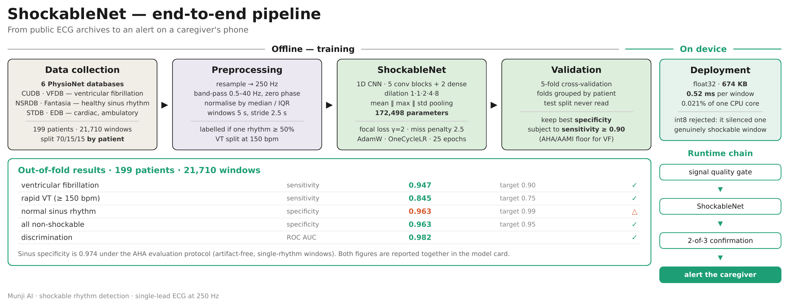
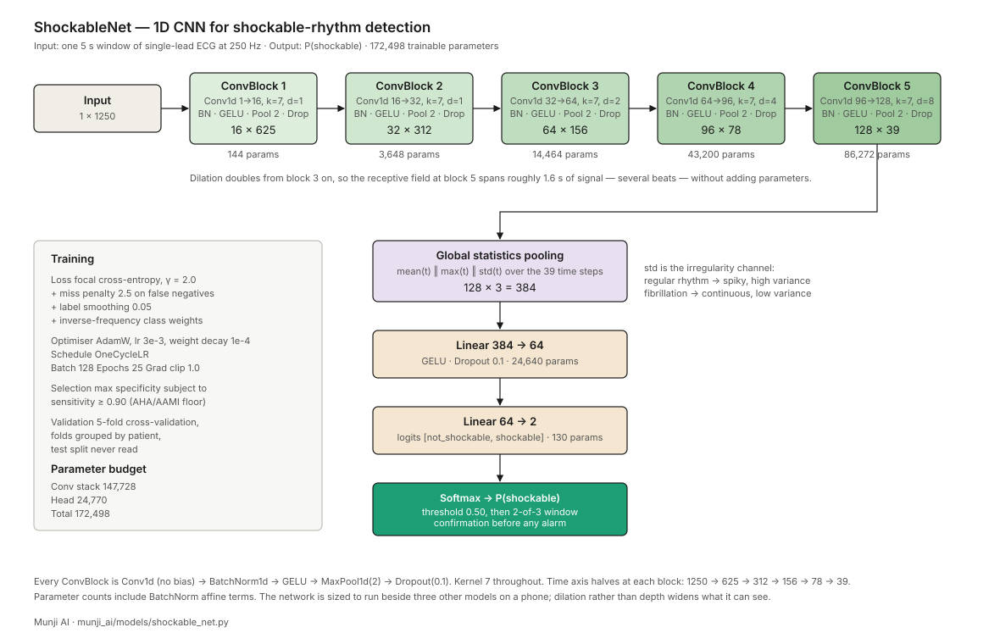

# ShockableNet — Model Card

| | |
|---|---|
| **Model** | `munji_ai/models/shockable_net.py` |
| **Task** | Detect shockable ventricular rhythm (ventricular fibrillation and rapid ventricular tachycardia) in 5-second windows of single-lead ambulatory ECG |
| **Version** | 1.0 · October 2026 |
| **Repository** | `github.com/furatsafa2001/munji_ai` |
| **Author** | Safa Khan, AI team |
| **Organisation** | مؤسسة عبدالرحمن المعشي لهندسة البرمجيات (Abdulrahman Al-Maashi Software Engineering Est.) |

---

## 0. Pipeline at a glance



---

## 1. Purpose and scope

Munji is a wearable single-lead ECG patch for continuous home monitoring of cardiac patients, with caregiver alerting. ShockableNet is the component responsible for the one event that kills within minutes: a ventricular rhythm that no longer pumps blood. It classifies each 5-second window as `shockable` or `not_shockable`, and its output feeds a confirmation rule before any alarm is raised.

The model does **not** detect ischaemia, infarction, valve disease or heart failure. Its scope is the two rhythm classes named above, and nothing in its output should be read as absence of other disease.

---

## 2. Data

### 2.1 Sources

All data is public and drawn from PhysioNet. Six databases feed this stage.

| Database | Version | Records | Native rate | Role here | Annotation type |
|---|---|---|---|---|---|
| CUDB — Creighton University Ventricular Tachyarrhythmia | 1.0.0 | 35 | 250 Hz | Shockable + negatives | Beat labels + event markers `[` `]` for VF episodes |
| VFDB — MIT-BIH Malignant Ventricular Arrhythmia | 1.0.0 | 22 | 250 Hz | Shockable + negatives | Rhythm labels in `aux_note` |
| NSRDB — MIT-BIH Normal Sinus Rhythm | 1.0.0 | 18 | 128 Hz | Negatives | Beat labels only |
| Fantasia | 1.0.0 | 40 | 250 Hz | Negatives | Beat labels only (`.ecg`) |
| STDB — MIT-BIH ST Change | 1.0.0 | 28 | 360 Hz | Negatives | Beat labels only |
| EDB — European ST-T | 1.0.0 | 90 | 250 Hz | Negatives | Rhythm labels + ST/T episode markers |

**Why these six.** CUDB and VFDB are the standard shockable-rhythm corpora in the AED literature and are the only open sources of ventricular fibrillation with rhythm-level annotation. The other four were added to supply ordinary rhythm from the population the device is for. NSRDB contributes screened healthy sinus rhythm; Fantasia contributes 20 elderly healthy subjects; STDB contributes cardiac patients in sinus rhythm under exertion; EDB contributes 79 ambulatory cardiac patients aged 30 to 84. Together they cover young and old, healthy and cardiac, at rest and moving.

### 2.2 Annotation handling

Each database encodes rhythm differently, and several conventions had to be resolved before the labels were usable.

**CUDB.** Fibrillation episodes are marked by WFDB event symbols `[` (onset) and `]` (end), not by rhythm strings. The stretch before the first `[` is labelled `(N` — by definition pre-arrest. The stretch after `]` is labelled `UNKNOWN` and dropped: the post-fibrillation state is not known to be safe.

**VFDB.** Rhythm labels appear in `aux_note`. `(NOISE` is retained as an interval marker rather than removed, because PhysioNet's annotation key specifies that the previous rhythm continues through a noise episode; windows dominated by it are dropped.

**Ventricular tachycardia.** The databases label `VT` without rate. Following the AHA rhythm classification scheme, VT at ≥ 150 bpm is shockable and slower VT is intermediate. Rate is measured from the signal (VFDB carries no beat annotations), using peak detection on the rectified trace; episodes at ≥ 150 bpm become `VT_FAST` and enter the shockable class, slower episodes are excluded from this stage.

**Beat-only databases (NSRDB, Fantasia, STDB).** These carry no rhythm-change markers. A `baseline_rhythm` field in the registry declares the whole record sinus — safe by construction for NSRDB and Fantasia, whose subjects were screened, and an assumption for STDB's supervised stress tests that measurement supported (VF sensitivity unchanged after inclusion).

**EDB.** Its ST and T episode markers are left outside the rhythm map, so the loader treats them as unrecognised rhythm and drops the windows they dominate. This loses coverage but mislabels nothing.

### 2.3 Class definition

```
SHOCKABLE_RHYTHMS   = ("VF", "VT_FAST")      # VFL maps to VF upstream
VT_FAST_BPM         = 150.0
SHOCKABLE_EXCLUDED  = ("NOISE", "UNKNOWN", "VT")   # unmeasurable or slow VT
```

### 2.4 Windows and splits

| Parameter | Value |
|---|---|
| Window | 5.0 s (1250 samples at 250 Hz) |
| Stride | 2.5 s (50% overlap) |
| Rhythm purity | a window is labelled only if one rhythm covers ≥ 50% of it |
| Per-patient cap | 400 windows, episode-bearing windows prioritised |
| Split | 70 / 15 / 15 by **patient**, seed 20260817 |

Splitting is at patient level: no subject appears in more than one split. A leak check runs at build time and raises on any overlap.

| Split | Windows | Patients | shockable | not_shockable |
|---|---|---|---|---|
| train | 18,228 | 167 | 1,627 | 16,601 |
| val | 3,482 | 32 | 446 | 3,036 |
| test | 3,638 | 33 | 340 | 3,298 |

The test split has not been read during any part of development and is reserved for one final measurement.

---

## 3. Preprocessing

All inputs pass through `munji_ai/data/preprocess.py`.

1. **Resample to 250 Hz** — scipy polyphase resampling. Native rates range from 128 to 360 Hz. CUDB, VFDB, Fantasia and EDB are native 250 Hz and pass through unchanged.
2. **Band-pass 0.5 – 40 Hz** — 4th-order Butterworth, zero-phase (`sosfiltfilt`), so R-peak timing is preserved (measured drift 0 samples). A separate diagnostic path at 0.05 – 40 Hz with a 50 Hz notch is kept for storage; it is not used by this model.
3. **Robust normalisation** — per window, subtract the median and divide by the interquartile range. Scale-free, so a database with miscalibrated gain normalises to the same thing as one with correct units; and a single motion spike barely moves the scale.
4. **Window extraction** as in §2.4.

No augmentation is applied at this stage. The signal-quality gate (a separate model) runs upstream in deployment and is not part of this model's input.

---

## 4. Architecture



### 4.1 Layer by layer

| Stage | Layer | Output shape | Parameters |
|---|---|---|---|
| Input | — | 1 × 1250 | — |
| ConvBlock 1 | Conv1d 1→16, k=7, d=1 · BN · GELU · MaxPool 2 · Dropout 0.1 | 16 × 625 | 144 |
| ConvBlock 2 | Conv1d 16→32, k=7, d=1 · BN · GELU · MaxPool 2 · Dropout 0.1 | 32 × 312 | 3,648 |
| ConvBlock 3 | Conv1d 32→64, k=7, d=2 · BN · GELU · MaxPool 2 · Dropout 0.1 | 64 × 156 | 14,464 |
| ConvBlock 4 | Conv1d 64→96, k=7, d=4 · BN · GELU · MaxPool 2 · Dropout 0.1 | 96 × 78 | 43,200 |
| ConvBlock 5 | Conv1d 96→128, k=7, d=8 · BN · GELU · MaxPool 2 · Dropout 0.1 | 128 × 39 | 86,272 |
| Global pooling | concat[ mean(t), max(t), std(t) ] | 384 | — |
| Head | Linear 384→64 · GELU · Dropout 0.1 | 64 | 24,640 |
| Output | Linear 64→2 | 2 | 130 |
| **Total** | | | **172,498** |

**Footprint.** 674 KB in float32, 20.3 M multiply-accumulates per 5-second window. On one
CPU thread of an Apple M-series laptop, 0.52 ms per window against a 2.5 s stride — a duty
cycle of 0.021% of one core, or about 0.10% on a phone CPU five times slower.

**Shipped in float32, deliberately.** Dynamic int8 quantisation would cut the weights to
168 KB, but it saves no time at all (0.54 ms against 0.52 ms) and, measured on 2,000
validation windows, it moves three decisions — one of which turns a genuinely shockable
window into a safe one. Counting the flips would have called that negligible at 0.15%;
reading their direction does not. Half a megabyte is not worth a new miss in the one class
this model exists to catch.

### 4.2 Design rationale

**Small on purpose.** The model runs on a phone beside three other networks (signal quality, beat segmentation, rhythm classification). At 172k parameters it is an order of magnitude below the 770k ConvNeXt-based detectors in recent literature and well under the budget of commercial implantable algorithms. A five-block convolutional stack with a two-layer head follows the published pattern for resource-constrained ventricular arrhythmia detection.

**Dilation instead of depth.** Dilation doubles from block 3 onward (1, 1, 2, 4, 8), so the receptive field at the final block spans roughly 1.6 seconds of signal — several beats — without adding parameters. Fibrillation is a property of the whole trace, not of one complex, and the network has to see enough of it to judge.

**Three-statistic pooling.** Mean and max are the usual choices. Standard deviation across time is added because it directly encodes the distinction this task turns on: regular rhythm produces spiky, high-variance activations (a QRS, then quiet), while fibrillation produces continuous activity and low variance. It is a measure of irregularity obtained without detecting a single beat, which is why it stays robust under motion artifact where R-peak detectors fail.

**Local ConvBlock copy.** Each of the four models in the pipeline keeps its own `ConvBlock` rather than importing a shared one. They are tuned against different failure modes, and a change made for the quality gate must not silently alter a detector whose sensitivity is a safety claim.

**Compatibility with published work.** The architecture is a project-internal design, not a reproduction of a paper. Its choices sit within published practice: five convolutional blocks and a two-layer head match the resource-constrained detector in Zhao et al. (arXiv 2008.08060); the 5-second window matches the segment length used on the same databases in Hybrid 1D-CNN/Bi-LSTM work; the parameter count sits between the 70k baseline and 770k main model of the 2025 ConvNeXt AF detector.

---

## 5. Training

### 5.1 Loss

```python
MissPenaltyLoss(
    class_weights   = inverse frequency over {shockable, not_shockable},
    miss_penalty    = 2.5,     # multiplier on false negatives
    label_smoothing = 0.05,
    gamma           = 2.0,     # focal modulation (1 - p)^gamma
)
```

Three components, each addressing a different problem.

**Focal modulation (γ = 2.0)** down-weights windows the model already classifies correctly, so the gradient is not dominated by thousands of obvious sinus windows and goes instead to boundary cases. It also regularises confidence: cross-entropy is known to produce overconfident predictions in high-capacity networks, and focal loss acts as an implicit entropy regulariser. γ = 2 is the published default and the value used throughout the 2026 comparative evaluation of ECG architectures. Setting γ = 0 recovers plain weighted cross-entropy exactly, which made the comparison controlled.

**Miss penalty (2.5)** multiplies the loss on false negatives. Missing fibrillation and raising a false alarm are not equally costly — the first is a death in minutes, the second is a phone call. The penalty is bounded: pushed further, the model labels everything shockable, sensitivity reaches 1.0 and specificity collapses, which is a failure that does not show in the sensitivity column.

**Label smoothing (0.05)** softens the targets slightly. CUDB's own documentation describes its episode boundaries as approximate, so hard labels at the edges would be false precision.

### 5.2 Optimisation

| | |
|---|---|
| Optimiser | AdamW, lr 3 × 10⁻³, weight decay 10⁻⁴ |
| Schedule | OneCycleLR over the full run |
| Batch | 128 |
| Epochs | 25 (early stopping, patience 8, in the single-split script) |
| Gradient clipping | L2 norm 1.0 |
| Device | Apple MPS |

### 5.3 Model selection

The validation metric is **specificity subject to sensitivity ≥ 0.90**. Sensitivity is a constraint, not an objective: among epochs that clear the AHA/AAMI floor for VF, the one with the highest specificity is kept. If no epoch clears the floor, nothing is saved and the script says so. The floor is not negotiable and is never lowered to make a run pass.

### 5.4 Validation protocol

Five-fold cross-validation, folds grouped by patient, over the pooled train and validation splits (21,710 windows, 199 patients). Each patient is predicted exactly once by a model that never saw them. The test split is not read.

Reported figures are the mean and standard deviation across folds, and pooled out-of-fold metrics over all 199 patients.

### 5.5 Confirmation rule

The model's per-window decision is not an alarm. `CONFIRMATION["vf"] = (2, 3)` requires two positive windows among any three consecutive ones before an alert is raised. At a 2.5-second stride this is roughly five seconds of sustained detection — long enough to suppress a single noisy window, short enough that no episode of clinical length is delayed.

---

## 6. Results

All figures are out-of-fold: every window scored by a model that did not train on its patient.

### 6.1 Headline

| Metric | 5-fold mean ± sd | Pooled OOF |
|---|---|---|
| Sensitivity | 0.941 ± 0.031 | 0.933 |
| Specificity | 0.963 ± 0.009 | 0.963 |
| ROC AUC | 0.984 ± 0.009 | 0.982 |
| Macro F1 | 0.888 ± 0.035 | 0.898 |

Across three random seeds on the same data, sensitivity varies by about ±0.012 and specificity by about ±0.005. Differences smaller than that are not reported as differences.

### 6.2 Per rhythm class

Reported per class, as AED studies do, because a pooled specificity has no published target and hides which class is failing.

| Rhythm | Windows | Metric | Value | AHA target | |
|---|---|---|---|---|---|
| VF | 1,796 | Sensitivity | **0.947** | > 0.90 | ✓ |
| VT (≥ 150 bpm) | 277 | Sensitivity | **0.845** | > 0.75 | ✓ |
| Normal sinus rhythm | 12,480 | Specificity | 0.963 | > 0.99 | below |
| Other non-shockable | 6,415 | Specificity | 0.980 | > 0.95 | ✓ |
| Atrial fibrillation | 460 | Specificity | 0.996 | — | |
| SVT | 121 | Specificity | 1.000 | — | |

Both shockable classes clear their AHA/AAMI targets. Normal sinus rhythm does not, and §7 explains why.

### 6.3 Episode level, after confirmation

| | |
|---|---|
| Shockable episodes in the pooled set | 64 |
| Caught | 60 |
| Missed | 4 |
| Episode sensitivity | 0.938 |
| False alarms | 86 |

Episode count is small enough that ±1 is noise between seeds; it is reported as a count, not quoted as a rate.

### 6.4 Under the AHA evaluation protocol

Published AED figures are measured on artifact-free segments containing a single continuous rhythm. Applying the same selection (rhythm purity ≥ 0.95, signal quality above the 20th percentile) to the same predictions:

| | All windows | AHA protocol |
|---|---|---|
| Windows scored | 21,710 | 17,198 (79%) |
| Sensitivity | 0.933 | 0.922 |
| Specificity | 0.963 | 0.976 |
| Sinus specificity | 0.963 | **0.974** |

The 4,512 windows the protocol excludes are boundary and artifact windows; the device will meet them in the field. Both columns are reported, always together.

### 6.5 Comparison with published work

| Study | Data | VF sens. | NSR spec. |
|---|---|---|---|
| Cascade SBAE (2026) | CUDB+VFDB+SDDB+AFDB, manufacturer test set | 0.975 | 0.993 |
| CNNED cascade (2024) | CUDB+VFDB+SDDB+AFDB, manufacturer test set | — | 0.9935 |
| Defibtech commercial algorithm | clean ECG | 0.986 | 0.995 |
| CNN time-frequency (2023) | CUDB+VFDB | 0.945 (VT) | 0.983 |
| **ShockableNet, all windows** | 6 PhysioNet DBs, 199 patients | **0.947** | **0.963** |
| **ShockableNet, AHA protocol** | same | 0.930 | **0.974** |

Sensitivity on fibrillation is in line with the field. Sinus specificity is 1.6 points below the published range under matched protocol, and further below on unselected data. Published figures are measured on curated test sets, often supplied by the device manufacturer, after excluding a substantial share of patients; the figures here are on raw PhysioNet with every patient retained.

### 6.6 Figures

All four are produced from the cross-validation predictions by
`munji_ai/eval/plot_eval.py --oof`, so every window shown was scored by a model
that never trained on its patient.


**Confusion matrix.** 18,916 correct rejections against 721 false alarms;
1,935 shockable windows caught against 138 missed. The row percentages are the
specificity and sensitivity quoted above.


**ROC and precision-recall.** AUC 0.982. The operating point sits above the
0.90 sensitivity floor, and the curve is close enough to the corner that the
threshold could be moved in either direction without collapsing the other
metric. Average precision is 0.761 against a 9.5% prevalence, which is the
number that reflects how rare the positive class is.


**Score distribution.** The two classes separate almost completely: negatives
pile at 0.0, positives spread between 0.6 and 0.95, and the region around the
0.5 threshold is nearly empty. A model that were merely lucky would leave both
classes heaped near the middle. This is the figure that says the model is right
for a reason rather than by coincidence.


**Per-patient error rate.** The worst 40 of 199 patients. Fifteen sit above the
0.20 line, all of them from CUDB and VFDB — the arrest recordings, where the
signal is hardest and the annotation boundaries are documented as approximate.
A pooled score hides these, which is why they are plotted.

---

## 7. Known limitations

**Sinus specificity is below the 0.99 target.** The remaining gap traces to the training distribution: no open database contains ordinary sinus rhythm from elderly cardiac patients recorded while moving, which is the population and condition the device is for. The nearest available sources (NSRDB: healthy 20–50; Fantasia: elderly at rest; STDB: cardiac under supervised exertion; EDB: ambulatory cardiac) each close part of the gap and were all added. Closing the rest requires data from the device itself, clinically annotated.

**Public data is optimistic.** Fibrillation in CUDB and VFDB is coarse, high-amplitude, and cleanly bounded. Field fibrillation several minutes into an arrest looks different, and detection on public corpora is documented to be easier than on out-of-hospital recordings. Figures here are a comparison point, not an expected field rate.

**Prevalence is unrealistic.** Shockable rhythm is 9% of windows here and near zero in a home monitor. At field prevalence, the same specificity produces proportionally more false alarms; the confirmation rule and the upstream quality gate are the mitigations.

**Single lead.** The model sees one projection of the cardiac vector. It is not designed to detect ischaemia and does not attempt to.

**Not clinical judgement.** The output is an alert to a caregiver, not a diagnosis. Every alert should be acted on by a person.

---

## 8. Files

| Path | Role |
|---|---|
| `munji_ai/models/shockable_net.py` | Model, loss, class weights |
| `munji_ai/train/train_shockable.py` | Single-split training with episode-level reporting |
| `munji_ai/train/cross_validate.py` | Patient-grouped k-fold, out-of-fold predictions |
| `munji_ai/eval/report_by_rhythm.py` | Per-class metrics against AHA targets |
| `munji_ai/eval/aha_protocol.py` | Artifact-free single-rhythm evaluation |
| `munji_ai/eval/plot_eval.py` | Confusion, ROC/PR, probability, per-patient figures |
| `munji_ai/eval/inspect_failures.py` | Per-patient failure analysis |
| `munji_ai/data/registry.py` | Dataset definitions and stage assignment |
| `munji_ai/data/loader.py` | Annotation parsing, rhythm intervals, VT rate split |
| `munji_ai/data/windows.py` | Window extraction, cache, config hash |
| `munji_ai/config.py` | All thresholds and constants |

---

## 9. References

### Standards

1. Kerber RE, Becker LB, Bourland JD, et al. Automatic External Defibrillators for Public Access Defibrillation: Recommendations for Specifying and Reporting Arrhythmia Analysis Algorithm Performance. *Circulation.* 1997;95(6):1677–1682. https://www.ahajournals.org/doi/full/10.1161/01.CIR.95.6.1677
2. ANSI/AAMI DF80. Medical electrical equipment — Particular requirements for the basic safety and essential performance of cardiac defibrillators.
3. ANSI/AAMI EC57. Testing and reporting performance results of cardiac rhythm and ST segment measurement algorithms.

### Thresholds and protocol

4. Figuera C, Irusta U, Morgado E, et al. Machine Learning Techniques for the Detection of Shockable Rhythms in Automated External Defibrillators. *PLOS One.* 2016. https://pmc.ncbi.nlm.nih.gov/articles/PMC4956226/ — AHA targets: Se > 90% shockable, Sp > 95% non-shockable, Sp > 99% NSR.
5. Krasteva V, Jekova I. Shock advisory tool: Detection of life-threatening cardiac arrhythmias and shock success prediction by means of a common parameter set. *Biomed Signal Process Control.* 2007;2(1):25–33. https://www.sciencedirect.com/science/article/abs/pii/S1746809407000110 — 150 bpm rapid-VT threshold.
6. Picon A, Irusta U, Álvarez-Gila A, et al. Mixed convolutional and long short-term memory network for the detection of lethal ventricular arrhythmia. *PLOS One.* 2019;14(5):e0216756. https://journals.plos.org/plosone/article?id=10.1371/journal.pone.0216756 — public-corpus optimism; patient-level splitting.

### Comparison studies

7. Cascade Skip-Connection BiLSTM Autoencoder for CPR Artifact Removal Prior to AED Shock Advisory. *IEEE Open J Comput Soc.* 2026. https://doi.org/10.1109/ojcs.2026.3696482 — training corpus, per-rhythm reporting, 99.30% NSR specificity.
8. Enhancing the accuracy of shock advisory algorithms in AEDs during ongoing CPR using a cascade of CNNEDs. *Comput Biol Med.* 2024. https://www.sciencedirect.com/science/article/pii/S0010482524002646 — AFDB as negative source, 99.35% NSR specificity.
9. Efficient Extraction of Deep Image Features Using a CNN for Detecting VF and VT. *J Imaging.* 2023. https://doi.org/10.3390/jimaging9090190

### Method

10. Mukhoti J, Kulharia V, Sanyal A, et al. Calibrating Deep Neural Networks using Focal Loss. *NeurIPS.* 2020. https://arxiv.org/abs/2002.09437
11. Deep Neural Network Architectures for Electrocardiogram Classification: A Comprehensive Evaluation. 2026. https://arxiv.org/abs/2602.17701 — focal loss, AdamW as standard training recipe.
12. Zhao Z, et al. Personalized Deep Learning for Ventricular Arrhythmias Detection on Medical IoT Systems. 2020. https://arxiv.org/abs/2008.08060 — five-block CNN for resource-constrained detection.

### Data

13. Goldberger AL, Amaral LAN, Glass L, et al. PhysioBank, PhysioToolkit, and PhysioNet. *Circulation.* 2000;101(23):e215–e220.
14. CUDB — https://physionet.org/content/cudb/1.0.0/
15. VFDB — https://physionet.org/content/vfdb/1.0.0/ · annotation key: https://archive.physionet.org/physiobank/database/vfdb/annotations.shtml
16. NSRDB — https://physionet.org/content/nsrdb/1.0.0/
17. Fantasia — https://physionet.org/content/fantasia/1.0.0/
18. STDB — https://physionet.org/content/stdb/1.0.0/
19. EDB — https://physionet.org/content/edb/1.0.0/
